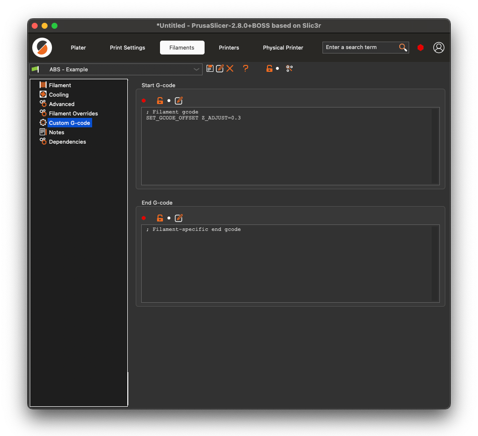
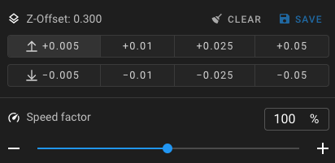

## Introduction

Different filament materials often need different Z offsets for good bed adhesion and first layer squish. Adjusting the offset by hand for every print is slow and error prone. This guide shows how to configure your slicer to apply the Z offset automatically for each print. It also shows how to change the `PRINT_END` macro so the Z offset returns to its default when a print finishes.

## Prerequisites

You need:

- A 3D printer running Klipper
- A slicer that supports filament-specific start G-code, such as:
  - PrusaSlicer
  - SuperSlicer
  - OrcaSlicer
- "Advanced" settings enabled in your slicer, to reach the configuration options used below.

## Modifying the PRINT_END macro

Your `printer.cfg` should already contain a `PRINT_END` macro, since it is part of the standard Voron configuration. If it does not, use the template in the callout below. Append the following command to the end of the macro:

```ini title="printer.cfg"
    SET_GCODE_OFFSET Z=0
```

If your macro uses `SAVE_GCODE_STATE` and `RESTORE_GCODE_STATE`, put the new command after `RESTORE_GCODE_STATE`. `RESTORE_GCODE_STATE` also restores the saved G-code offset, so a command placed before it is undone. The offset would then change a little with each print instead of returning to the baseline.

`SET_GCODE_OFFSET Z=0` sets the Z offset to zero, so later G-code commands run without a Z offset. The next print starts from a known baseline.

:::tip[No PRINT_END macro?]
The stock Voron Klipper configuration includes a `PRINT_END` macro. If yours does not define one, use the snippet below.

<details>
<summary>Macro: PRINT_END</summary>

```ini title="printer.cfg"
[gcode_macro PRINT_END]
gcode:
    # safe anti-stringing move coords
    
    
    
    

    SAVE_GCODE_STATE NAME=STATE_PRINT_END

    M400                           ; wait for buffer to clear
    G92 E0                         ; zero the extruder
    G1 E-5.0 F1800                 ; retract filament

    TURN_OFF_HEATERS

    G90                                      ; absolute positioning
    G0 X{x_safe} Y{y_safe} Z{z_safe} F20000  ; move nozzle to remove stringing
    G0 X{th.axis_maximum.x//2} Y{th.axis_maximum.y - 2} F3600  ; park nozzle at rear
    M107                                     ; turn off fan

    BED_MESH_CLEAR

    # The purpose of the SAVE_GCODE_STATE/RESTORE_GCODE_STATE
    # command pair is to restore the printer's coordinate system
    # and speed settings since the commands above change them.
    # However, to prevent any accidental, unintentional toolhead
    # moves when restoring the state, explicitly set MOVE=0.
    RESTORE_GCODE_STATE NAME=STATE_PRINT_END MOVE=0
```

</details>
:::

## Configuring filament settings in your slicer

This section uses PrusaSlicer as an example. Other slicers work the same way.

### Step 1: Open custom G-code

In your slicer, open Filament Settings and select the Custom G-code entry (highlighted in blue in the screenshot below).

### Step 2: Add start G-code

```text title="Start G-Code"
SET_GCODE_OFFSET Z_ADJUST=0.3
```



This uses `SET_GCODE_OFFSET` again, but with the `Z_ADJUST` parameter instead of the `Z` parameter used in `PRINT_END`. `Z` sets the offset to the given value. `Z_ADJUST` adds the given value to the current offset. For example, `SET_GCODE_OFFSET Z=-0.2` followed by `SET_GCODE_OFFSET Z_ADJUST=0.3` gives a Z offset of **0.1**. This is why the offset must be reset after each print.

## Verification

To check that the adjustment is applied:

1. Slice and start a new print.
2. Watch the Z offset while the printer prepares the print. If the configuration is correct, the web UI shows the expected Z offset in the Toolhead card, as in the screenshot below:

   

## Further reading

- Klipper [SET_GCODE_OFFSET](https://www.klipper3d.org/G-Codes.html#set_gcode_offset) documentation
