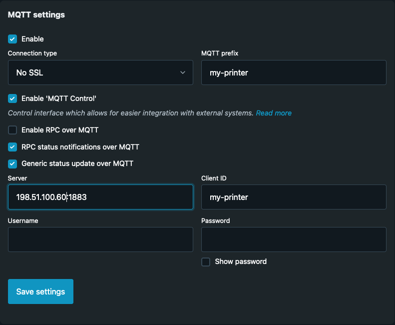
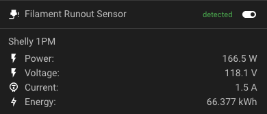
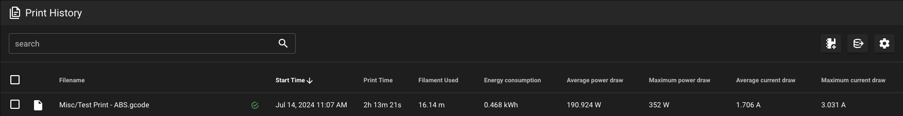

## Introduction

Moonraker can collect data from additional sensors, including power meters, and store it in its job history. With an energy monitor such as the Shelly 1PM series, you can see how much energy each print job used. This guide covers:

- Setting up an MQTT server so the Shelly and Moonraker can exchange data.
- Configuring Moonraker to poll and store the energy data.
- Configuring Moonraker sensors so Mainsail shows energy usage in the job history.

## Prerequisites

- A power meter or sensor that can publish measurements to an MQTT server. Compatible devices include the Shelly PM series (for example [Shelly 1PM Pro](https://www.shelly.com/en/products/shop/shelly-pro-1pm) or [Shelly 1PM Mini](https://www.shelly.com/en/products/shop/shelly-1-pm-mini-gen3)) and [Tasmota](https://tasmota.github.io/docs/)-based devices. This guide does not cover installing the device.
- The power meter must be on the same network as the Raspberry Pi that controls your printer.
- Mainsail 2.12.0 or newer.

:::note
This guide assumes a Shelly 1PM device. Make sure your device is compatible and installed before you continue.
:::

## MQTT server

MQTT (Message Queuing Telemetry Transport) is a lightweight protocol that lets Internet of Things (IoT) devices exchange messages. Here the power meter publishes measurements over MQTT at regular intervals, and Moonraker subscribes to receive them. You will install an MQTT server on the Raspberry Pi that controls the printer.

### Installation

Run the following commands over SSH.

:::note
This guide uses [Mosquitto](https://mosquitto.org/) as the MQTT server.
:::

1. Install the software

   ```bash title="Installing the Mosquitto server"
   sudo apt install -y mosquitto mosquitto-clients
   ```

1. Start Mosquitto automatically on boot

   ```bash title="Starting Mosquitto on printer startup"
   sudo systemctl enable mosquitto.service
   ```

### Configuration

For the MQTT server to receive messages from the power meter, it must listen on a network port. The steps below set up an unauthenticated (anonymous) connection.

:::danger[Security note]
If you expose your 3D printer or Raspberry Pi to the public internet, use an authenticated and encrypted connection. This guide does not cover setting one up. See the Mosquitto documentation on [Authentication Methods](https://mosquitto.org/documentation/authentication-methods/) and [SSL/TLS Support](https://mosquitto.org/man/mosquitto-conf-5.html).
:::

1. Open the configuration file

   ```bash title="Editing the configuration file"
   sudo nano /etc/mosquitto/mosquitto.conf
   ```

1. Append these settings to the end of the file

   ```ini title="mosquitto.conf"
   listener 1883
   allow_anonymous true
   ```

1. Save the file and exit the editor by pressing **CTRL-X**, then **Y**, then **Enter**
1. Restart Mosquitto to apply the configuration

   ```bash title="Restarting the Mosquitto service"
   sudo systemctl restart mosquitto
   ```

## Power meter

Next, configure the power meter to publish measurements to the MQTT server at regular intervals.

### Configuration

1. Find the IP address of your Raspberry Pi:

   ```bash title="Determining the primary IP address"
   hostname -I
   ```

   The output looks like this:

   ```text title="Output"
   py@voron: $ hostname -I
   198.51.100.60 198.51.100.61 2600:1700:5430:87af::1106 2001:0db8:5dc9:b0ba:f8a8:7e3c:45e2:faab 2001:0db8:5dc9:b0ba:f8a8:7e3c:45e2:faac
   ```

   Note the primary IP address, **198.51.100.60**, in the first column of the output. You need it in the next steps.

   :::note
   Your output will differ depending on your system settings.
   :::

1. Open the IP address of your Shelly device in a web browser to reach its web interface.
1. Go to **Settings > MQTT** in the **Connectivity** section.
1. Set the following:
    - **Enable**: Checked
    - **Connection type**: No SSL
    - **MQTT Prefix**: my-printer
    - **MQTT Control**: Enabled
    - **Generic status update over MQTT**: Enabled
    - **Server**: IP address of your Raspberry Pi (determined in step 1), followed by `:1883`, for example **198.51.100.60:1883**
    - **Client ID**: my-printer
    - **Username** and **Password**: Leave blank

   
1. Click **Save Settings**. You might need to restart the Shelly.

## Moonraker

Configure Moonraker to read the power meter as a sensor. Mainsail then shows live values, and the job history records them.

### MQTT configuration

1. Open the configuration file

   ```bash title="Editing the Moonraker configuration file"
   sudo nano ~/printer_data/config/moonraker.conf
   ```

1. Append these settings so Moonraker receives messages from the MQTT server

   ```ini title="moonraker.conf"
   [mqtt]
   address: 127.0.0.1
   enable_moonraker_api: False
   ```

### Sensor configuration

1. Append this block to define a sensor that subscribes to the MQTT messages from the Shelly 1PM

   ```ini title="moonraker.conf"
   [sensor powermeter]
   type: mqtt
   name: Shelly 1PM
   parameter_power:
     units=W
   parameter_voltage:
     units=V
   parameter_current:
     units=A
   parameter_energy:
     units=kWh
   state_topic: my-printer/status/switch:0
   state_response_template:
     
     {set_result("power", notification["apower"]|float)}
     {set_result("voltage", notification["voltage"]|float)}
     {set_result("current", notification["current"]|float)}
     {set_result("energy", notification["aenergy"]["total"]|float / 1000)}
   ```

   This extracts the following values from the Shelly 1PM status updates:

    - Current mains voltage
    - Current power draw
    - Current power usage
    - Total energy consumption (in kilowatt-hours)

1. Restart Moonraker to apply the configuration

   ```bash title="Restarting the Moonraker service"
   sudo systemctl restart moonraker
   ```

1. Check that data arrives

   Open the Mainsail web UI for your printer. If the integration works, the 'Miscellaneous Card' on the dashboard shows four new measurements from your sensor, as in the screenshot below:

   

   :::caution[Troubleshooting data exchange]
   If the data does not appear in the web UI, try the steps below.

   <details>
   <summary>Troubleshooting steps</summary>

   1. Check `moonraker.log` for configuration errors related to MQTT.
   2. Check that the power meter publishes data in the expected format. Use a tool like [MQTT Explorer](http://mqtt-explorer.com/) to connect to the MQTT server and inspect the messages.

   </details>
   :::

### Historical data

Moonraker can record auxiliary sensor data in the job history. To store this data, add history fields to the sensor.

1. Open the Moonraker configuration file

   ```bash title="Editing the Moonraker configuration file"
   sudo nano ~/printer_data/config/moonraker.conf
   ```

2. Add history fields to the sensor definition

   Append these lines to the sensor you defined earlier:

   ```ini title="moonraker.conf"
   history_field_energy_consumption:
     parameter=energy
     desc=Energy consumption
     strategy=delta
     units=kWh
     init_tracker=true
     precision=6
     exclude_paused=false
     report_total=true
     report_maximum=true
   history_field_average_power:
     parameter=power
     desc=Average power draw
     strategy=average
     units=W
     report_total=false
     report_maximum=true
   history_field_max_power:
     parameter=power
     desc=Maximum power draw
     strategy=maximum
     units=W
     init_tracker=true
     report_total=false
     report_maximum=false
   history_field_average_current:
     parameter=current
     desc=Average current draw
     strategy=average
     units=A
     report_total=false
     report_maximum=true
   history_field_max_current:
     parameter=current
     desc=Maximum current draw
     strategy=maximum
     units=A
     init_tracker=true
     report_total=false
     report_maximum=false
   ```

   These add fields for current draw, power usage and energy consumption, which Moonraker records in the job history when a print finishes.

3. Restart Moonraker to apply the configuration

   ```bash title="Restarting the Moonraker service"
   sudo systemctl restart moonraker
   ```

4. Check the data in Mainsail

   Open the Mainsail web UI for your printer. If the configuration is correct, the Job History section shows additional columns, as in the screenshot below:

   

   :::note
   The new fields are blank for existing job history entries. They are filled in as new print jobs finish.
   :::

## Further reading

- Moonraker [sensor configuration](https://moonraker.readthedocs.io/en/latest/configuration/#sensor) documentation
- Shelly [web interface guide](https://kb.shelly.cloud/knowledge-base/shelly-pro-1pm-web-interface-guide)
